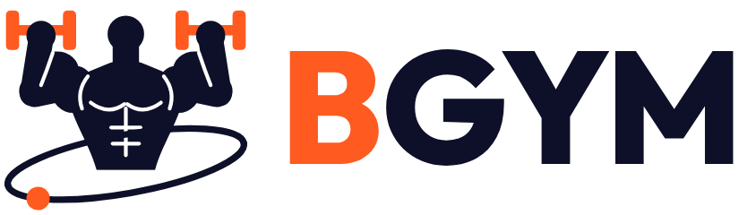

# BGYM

> **Be my Gym buddy.**

A fitness marketplace for Ghana, starting in Accra. Members find partner gyms near them, pay memberships and book personal trainers in-app, follow their gyms' content, train at home with guided workouts, and buy fitness products from our store.

## Surfaces

| Surface | Users | Tech |
|---|---|---|
| Mobile app | Members | iOS + Android (React Native / Expo) |
| Gym dashboard | Gym owners & staff | Responsive web (Next.js) |
| Trainer dashboard | Personal trainers (linked to a gym) | Responsive web |
| Partner (store) dashboard | Store product partner(s) | Responsive web |
| Admin dashboard | Platform team | Responsive web |

## Planning documents

1. [Product requirements](docs/01-product-requirements.md) — what we're building, by surface and tab
2. [User flows](docs/02-user-flows.md) — step-by-step journeys for every role
3. [Payments design](docs/03-payments.md) — Paystack subaccounts, splits, renewals, payouts
4. [Store & delivery](docs/04-store-and-delivery.md) — catalogue, orders, delivery recommendation
5. [Data model](docs/05-data-model.md) — core entities and relationships
6. [Architecture & tech stack](docs/06-architecture.md)
7. [Roadmap](docs/07-roadmap.md) — phases and MVP scope
8. [Decisions & open questions](docs/08-decisions-and-open-questions.md)
9. [Name check: Orbyt](docs/09-name-check-orbyt.md) (earlier name, superseded by BGYM)

## Brand

Logo, app icon, colours and typography: [brand/](brand/README.md). The earlier Orbyt kit is archived in `brand/archive/orbyt/`.
