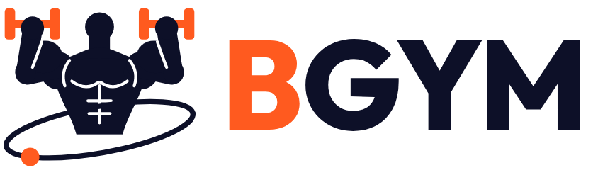

# BGYM

> **Be my Gym buddy.**



A fitness marketplace for Ghana, starting in Accra. Members find partner gyms near them, pay memberships and book personal trainers in-app, follow their gyms' content, train at home with guided workouts, and buy fitness products from our store.

## Repository

| Path | What it is | Tech |
|---|---|---|
| `apps/mobile` | Member app for iOS and Android | Expo SDK 58, React Native, Expo Router, Reanimated |
| `apps/web` | Gym, trainer, store partner and admin dashboards | Next.js 16, Tailwind CSS 4 |
| `apps/api` | Backend API | NestJS 12, Prisma 7, PostgreSQL 17 + PostGIS |
| `packages/shared` | Brand tokens, validation schemas, money helpers | TypeScript, zod |
| `brand/`, `design/` | Brand kit, wireframes, splash animation | |
| `docs/` | Product and technical planning | |

## Getting started

**You need:** Node.js 22 (see `.nvmrc`), pnpm 10 (`corepack enable`), Docker Desktop, and the Expo Go app on your phone.

```bash
pnpm install
```

```bash
cp apps/api/.env.example apps/api/.env && cp apps/web/.env.example apps/web/.env.local && cp apps/mobile/.env.example apps/mobile/.env
```

Start PostgreSQL + PostGIS and Redis, create the tables, and load sample gyms:

```bash
pnpm db:up && pnpm db:migrate && pnpm db:seed
```

Run the API (http://localhost:4000, API docs at `/docs`) and the dashboards (http://localhost:3000). In development, sign-in codes are printed in this terminal instead of being emailed (`MAIL_DRIVER=log` in `apps/api/.env`):

```bash
pnpm dev
```

Payments run in development mode (`PAYMENTS_DRIVER=dev` in `apps/api/.env`): checkout shows a test approval sheet instead of Paystack, and no real money moves. To test real Paystack checkout, set `PAYMENTS_DRIVER=paystack` and `PAYSTACK_SECRET_KEY=sk_test_…`.

Run the mobile app, then scan the QR code with Expo Go (phone and computer on the same Wi-Fi). On a physical phone, set `EXPO_PUBLIC_API_URL` in `apps/mobile/.env` to your computer's LAN address, e.g. `http://192.168.1.20:4000`.

```bash
pnpm dev:mobile
```

### Everyday commands

| Command | What it does |
|---|---|
| `pnpm lint` / `pnpm typecheck` / `pnpm test` / `pnpm build` | Checks for every app and package (Turborepo) |
| `pnpm --filter @bgym/api test:e2e` | API end-to-end tests against the local database |
| `pnpm --filter @bgym/api db:migrate:new --name <change>` | Create a new database migration after editing `schema.prisma` |
| `pnpm db:studio` | Browse the local database |
| `pnpm --filter @bgym/mobile generate:brand` | Regenerate the app's logo components from `brand/svg` |

Every push runs CI: lint, typecheck, unit tests, builds, API end-to-end tests on PostGIS, iOS/Android bundling, a dependency audit, and CodeQL. Security practices are in [SECURITY.md](SECURITY.md).

## Surfaces

| Surface | Users | Tech |
|---|---|---|
| Mobile app | Members | iOS + Android (React Native / Expo) |
| Gym dashboard | Gym owners & staff | Responsive web (Next.js) |
| Trainer dashboard | Personal trainers (linked to a gym) | Responsive web |
| Partner (store) dashboard | Store product partner(s) | Responsive web |
| Admin dashboard | Platform team | Responsive web |

## Planning documents

1. [Product requirements](docs/01-product-requirements.md) — what we're building, by surface and tab
2. [User flows](docs/02-user-flows.md) — step-by-step journeys for every role
3. [Payments design](docs/03-payments.md) — Paystack subaccounts, splits, renewals, payouts
4. [Store & delivery](docs/04-store-and-delivery.md) — catalogue, orders, delivery recommendation
5. [Data model](docs/05-data-model.md) — core entities and relationships
6. [Architecture & tech stack](docs/06-architecture.md)
7. [Roadmap](docs/07-roadmap.md) — phases and MVP scope
8. [Decisions & open questions](docs/08-decisions-and-open-questions.md)
9. [Name check: Orbyt](docs/09-name-check-orbyt.md) (earlier name, superseded by BGYM)
10. [Name check: BGYM](docs/10-name-check-bgym.md)

## Brand

Logo, app icon, colours and typography: [brand/](brand/README.md). The earlier Orbyt kit is archived in `brand/archive/orbyt/`.

## Design

Wireframes (member app, plus gym, trainer, store partner and admin dashboards): [design/wireframes/](design/wireframes/README.md)
