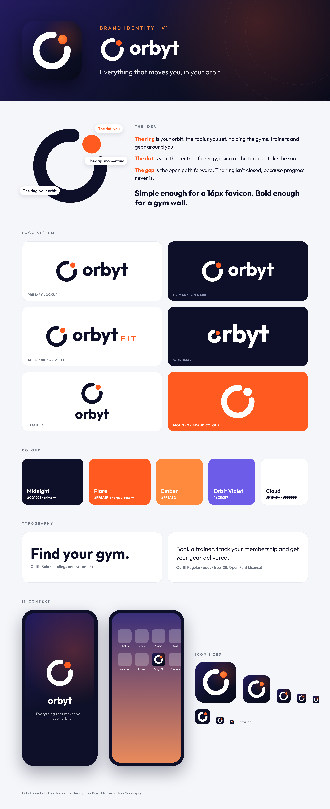

# Orbyt — Brand Kit v1

## The idea
The mark is an **orbit ring with a dot**.
- **The ring** is your orbit: the radius you set in the app, holding the gyms, trainers and gear around you.
- **The dot** is you, the centre of energy, rising at the top-right like the sun.
- **The gap** is the open path forward. The ring isn't closed, because progress never is.

Tagline: **Everything that moves you, in your orbit.**

## Files
| File | Use |
|---|---|
| `svg/orbyt-lockup.svg` / `-on-dark` | **Primary logo** (mark + wordmark) |
| `svg/orbyt-fit-lockup.svg` / `-on-dark` | App store and marketing ("Orbyt Fit") |
| `svg/orbyt-stacked.svg` / `-on-dark` | Square spaces, social profile banners |
| `svg/orbyt-wordmark.svg` / `-on-dark` | Wordmark only, where the mark already appears nearby |
| `svg/orbyt-mark.svg` / `-on-dark` | Symbol only |
| `svg/orbyt-mark-mono-dark.svg` / `-mono-white` | One-colour uses: stamps, embroidery, engraving, on Flare backgrounds |
| `svg/orbyt-app-icon.svg` | iOS app icon source (full-bleed 1024; iOS applies the rounded corners) |
| `svg/orbyt-android-foreground.svg` + `-background.svg` | Android adaptive icon layers (108dp) |
| `svg/orbyt-favicon.svg` | Website favicon |
| `png/` | Ready-made PNG exports (app icon 1024, Play Store 512, favicon 32, Apple touch icon 180, logos) |

All text in the SVGs is converted to outlines, so no font needs to be installed to use them.

## Colour
| Name | Hex | Role |
|---|---|---|
| Midnight | `#0D1028` | Primary: text, dark backgrounds, logo ink |
| Flare | `#FF5A1F` | Brand accent: the dot, CTAs, highlights |
| Ember | `#FF8A3D` | Gradient partner to Flare |
| Orbit Violet | `#6C5CE7` | Secondary UI accent (links, tags, charts) |
| Cloud | `#F5F6FA` / `#FFFFFF` | Light backgrounds |

Signature gradient (app icon and splash screen): `#231B5E → #0D1028 → #080A1A`, with a soft Flare glow at the top-right.

## Typography
**Outfit** (Google Fonts, SIL Open Font License, free for commercial use). Bold 700 for headings and the wordmark, Regular 400 / SemiBold 600 for UI and body text.

## Usage rules
- Keep clear space around the logo equal to the height of the dot.
- Minimum size: mark 16px (use the favicon version below 32px); lockup 96px wide.
- The dot is always Flare, except in mono versions.
- Don't rotate the mark, move the dot, close the gap, recolour the ring in Flare, or add effects like shadows or outlines.
- On photos, use the on-dark version over a dark overlay.
