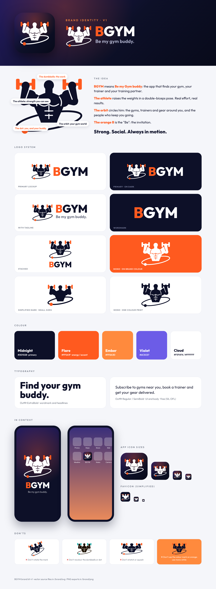

# BGYM — Brand Kit v1

## The idea
**BGYM = "Be my Gym buddy."** The app that finds your gym, your trainer and your training partner.

- **The athlete** raises orange dumbbells in a double-biceps pose: real effort, strength you can see.
- **The orbit** is tilted around him like a planet ring: the gyms, trainers and gear around you, and the people who keep you going.
- **The orange dot** on the orbit is you, and your buddy.
- **The orange B** in the wordmark is the "Be": the invitation.

Tagline: **Be my gym buddy.**

## Files (`svg/`, with PNG exports in `png/`)
| File | Use |
|---|---|
| `bgym-lockup` / `-on-dark` | **Primary logo** (mark + wordmark) |
| `bgym-lockup-tagline` / `-on-dark` | Marketing, website header, store listing graphics |
| `bgym-stacked` / `-on-dark` | Square spaces, social profiles, posters |
| `bgym-wordmark` / `-on-dark` | Text only, where the mark already appears nearby |
| `bgym-mark` / `-on-dark` | Symbol only |
| `bgym-mark-simple` / `-on-dark` | Simplified symbol (no muscle lines) for sizes under ~48px |
| `bgym-mark-mono-dark` / `-mono-white`, `bgym-lockup-mono-*` | One-colour uses: print, embroidery, engraving, on orange backgrounds |
| `bgym-app-icon` | iOS app icon (full-bleed 1024; iOS applies the rounded corners) |
| `bgym-android-foreground` + `-background` | Android adaptive icon layers (108dp, art inside the 66dp safe zone) |
| `bgym-favicon` | Website favicon (uses the simplified mark) |

All text is converted to outlines, so no font needs to be installed to use the files.

## Colour
| Name | Hex | Role |
|---|---|---|
| Midnight | `#0D1028` | Primary: the athlete, text, dark backgrounds |
| Flare | `#FF5A1F` | Accent: dumbbells, orbit dot, the "B", buttons |
| Ember | `#FF8A3D` | Gradient partner to Flare |
| Violet | `#6C5CE7` | Secondary UI accent |
| Cloud | `#F5F6FA` / `#FFFFFF` | Light backgrounds |

Signature gradient (app icon, splash screen): `#231B5E → #0D1028 → #080A1A`, with a soft Flare glow at the top.

## Typography
**Outfit** (SIL Open Font License, free for commercial use). ExtraBold 800 for the wordmark and headlines; Regular 400 / SemiBold 600 for UI and body text.

## Usage rules
- Clear space around the logo: at least the height of one dumbbell.
- Minimum sizes: full mark 48px tall; below that use `bgym-mark-simple`; lockup 120px wide.
- The dumbbells, orbit dot and "B" are always Flare orange, except in mono versions.
- On orange backgrounds, use the mono-white mark.
- Don't rotate, stretch, recolour or add effects (shadows, outlines, gradients) to the logo.

## Notes
- Muscled-figure logos are common for gyms; have a trademark lawyer clear the logo together with the name.
- Earlier explorations are in `explorations/`; the previous Orbyt kit is in `archive/orbyt/`.
