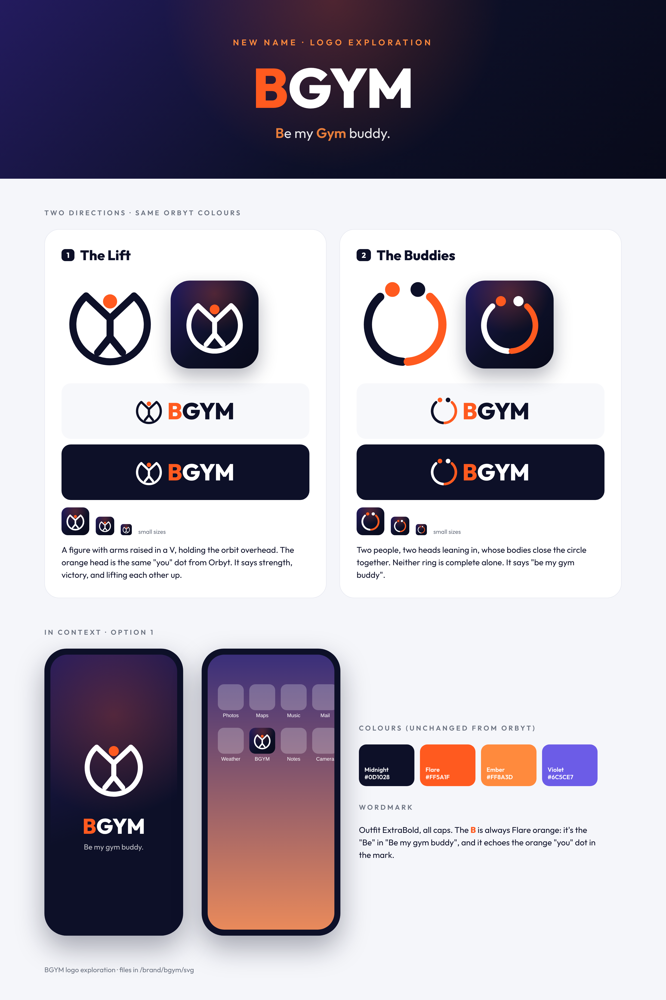
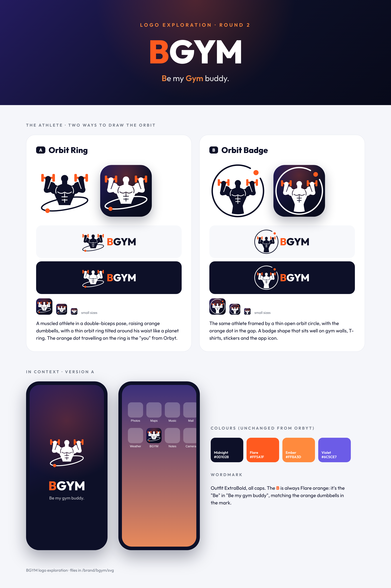

# BGYM — logo exploration

**BGYM = "Be my Gym buddy."** Uses the Orbyt colour palette (Midnight `#0D1028`, Flare `#FF5A1F`, Ember `#FF8A3D`, Violet `#6C5CE7`) and the Outfit typeface.

1. **The Lift** (`svg/bgym-athlete-*`): a figure with arms raised in a V, holding the orbit overhead; the orange head is the "you" dot.
2. **The Buddies** (`svg/bgym-buddies-*`): two figures whose bodies close one circle together.

Wordmark: Outfit ExtraBold, all caps, with the **B** always in Flare orange.

## Round 2: the muscled athlete

A muscled athlete in a double-biceps pose raising orange dumbbells, with a thin orbit around him.

- **A — Orbit Ring** (`svg/bgym-muscle-waist-*`): the orbit is tilted around his waist like a planet ring, with the orange dot travelling on it.
- **B — Orbit Badge** (`svg/bgym-muscle-round-*`): a thin open orbit circle frames him, with the orange dot in the gap.
