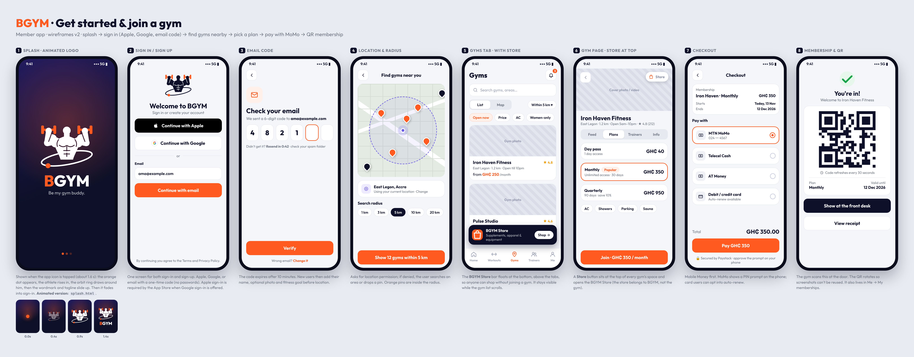
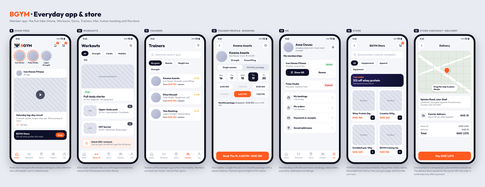
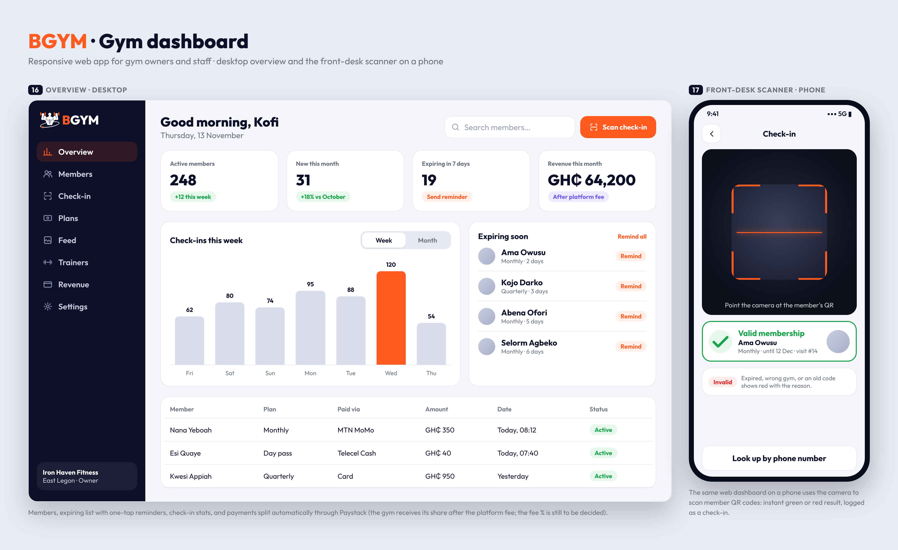

# BGYM Wireframes v2

Mid-fidelity wireframes in the BGYM look. Open `index.html` in a browser to view or edit them (fonts are bundled in `fonts/`, logos come from `../../brand/svg/`). PNG renders are in `png/`.

## 1. Get started & join a gym

1. Splash: animated logo (open `splash.html` to see it play; frames in `png/splash-frames.png`)
2. Sign in / sign up: Apple, Google, or email
3. Email code: 6-digit one-time code
4. Location & radius: use location or drop a pin, choose 1–20 km
5. Gyms tab: list/map, filters, plus a floating **BGYM Store** bar at the bottom
6. Gym page: **Store** button at the top; Feed · Plans · Trainers · Info
7. Checkout: MTN MoMo, Telecel Cash, AT Money, card (Paystack)
8. Membership & QR: rotating QR shown at the front desk

## 2. Everyday app & store

9. Home feed: posts from the member's gyms + store banner
10. Workouts: free basics, full library unlocked by any gym membership
11. Trainers: my gyms first, then nearby
12. Trainer profile & booking: single session or monthly package
13. Me: memberships (QR, renew), bookings, orders, payments
14. Store: categories, deals, product grid
15. Store checkout: map pin delivery, courier fee, pay before confirmation

## 3. Gym dashboard (responsive web)

16. Overview (desktop): KPIs, check-ins, expiring members, recent payments
17. Front-desk scanner (phone): scan member QR → valid / invalid

## Not yet wireframed
Trainer dashboard, store partner dashboard, admin dashboard, onboarding profile step (name, photo, goal), notifications, order tracking, renewals and empty/error states.

All names, gyms, prices and figures are placeholders.
