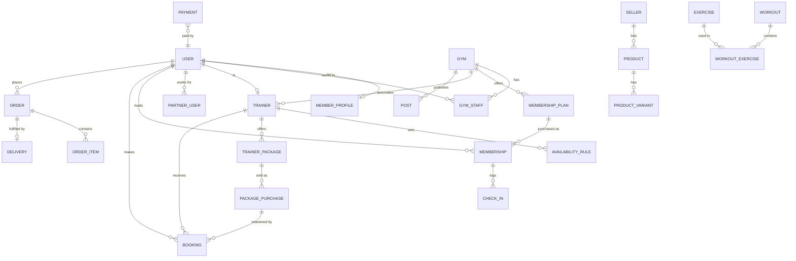

# 05 — Data Model (v1 draft)

PostgreSQL with the PostGIS extension (for "gyms within X km" queries). Monetary values stored as integer **pesewas** (GHS × 100). All tables have `id (uuid)`, `created_at`, `updated_at`.

## 1. Entity overview

## 2. Core tables

### Identity & roles
- **user** — phone (unique), email, name, avatar_url, status, last_login_at.
- **member_profile** — user_id, goal, gender, date_of_birth, home_location (geography point), search_radius_km.
- **gym_staff** — gym_id, user_id, role (`owner|manager|front_desk`).
- **partner_user** — partner_id, user_id, role.
- **admin_user** — user_id, role (`super_admin|ops|finance|support`).

### Gyms
- **gym** — name, slug, description, phone, email, address_text, location (geography point), opening_hours (jsonb), facilities (text[]), cover_url, status (`draft|pending_review|active|suspended`), platform_fee_pct (nullable override), paystack_subaccount_code.
- **gym_photo** — gym_id, url, sort_order.
- **membership_plan** — gym_id, name, duration_days, price, description, is_active.
- **membership** — user_id, gym_id, plan_id, status (`pending|active|expired|cancelled`), starts_at, ends_at, auto_renew, payment_id.
- **check_in** — membership_id, gym_id, user_id, scanned_by (staff user_id), result (`ok|expired|wrong_gym|invalid`), created_at.
- **post** — gym_id, author_user_id, body, status, like_count.
- **post_media** — post_id, type (`image|video`), url, playback_id, sort_order.
- **post_like** — post_id, user_id.

### Trainers
- **trainer** — user_id, gym_id, bio, specialties (text[]), certifications (jsonb), session_price, session_duration_min, cancellation_policy, status, paystack_subaccount_code.
- **availability_rule** — trainer_id, weekday, start_time, end_time.
- **availability_exception** — trainer_id, date, start_time, end_time, type (`blocked|extra`).
- **trainer_package** — trainer_id, name, sessions_count, validity_days, price, is_active.
- **package_purchase** — trainer_package_id, user_id, sessions_remaining, starts_at, ends_at, payment_id.
- **booking** — trainer_id, user_id, starts_at, ends_at, status (`pending|confirmed|completed|cancelled|no_show`), package_purchase_id (nullable), payment_id (nullable).

### Workouts
- **exercise** — external_id (licensed library), name, body_part, target_muscle, equipment, animation_url, instructions.
- **workout** — title, description, level, duration_min, cover_url, is_free.
- **workout_exercise** — workout_id, exercise_id, sort_order, sets, reps, duration_sec, rest_sec.
- **workout_session** — user_id, workout_id, completed_at.

### Store
- **seller** — type (`platform|partner`), name, commission_pct, paystack_subaccount_code.
- **pickup_location** — seller_id, address_text, location (point), contact_phone.
- **category** — name, parent_id, slug.
- **product** — seller_id, category_id, title, description, brand, status, is_featured.
- **product_image** — product_id, url, sort_order.
- **product_variant** — product_id, name, sku, price, compare_at_price, stock, weight_grams.
- **cart_item** — user_id, variant_id, quantity.
- **address** — user_id, label, location (point), address_text, landmark, gps_digital_address, contact_phone.
- **order** — user_id, status, subtotal, delivery_fee, total, address snapshot (jsonb), payment_id.
- **order_item** — order_id, variant_id, seller_id, title snapshot, unit_price, quantity.
- **delivery** — order_id, provider (`yango|manual`), external_id, status, courier_name, courier_phone, tracking_url, quoted_fee, actual_cost.

### Payments
- **payment** — user_id, type (`membership|trainer_session|trainer_package|store_order`), amount, currency, status (`pending|success|failed|refunded`), paystack_reference, channel (`mobile_money|card`), split_details (jsonb), platform_fee, metadata.
- **payment_event** — payment_id, raw webhook payload, event_type, received_at.
- **refund** — payment_id, amount, reason, status, initiated_by.

### Platform
- **notification** — user_id, type, title, body, data, read_at.
- **device_token** — user_id, platform, token.
- **report** — reporter_user_id, target_type, target_id, reason, status.
- **platform_setting** — key, value (e.g. default fee percentages).

## 3. Key queries
- Nearby gyms: `WHERE status='active' AND ST_DWithin(location, :point, :radius_m) ORDER BY ST_Distance(location, :point)`.
- Home feed: posts where `gym_id IN (active memberships of user)` ordered by `created_at DESC`, cursor-paginated.
- Workout unlock: `EXISTS (active membership for user)`.
- Trainer free slots: expand availability rules for the date − exceptions − confirmed bookings.
